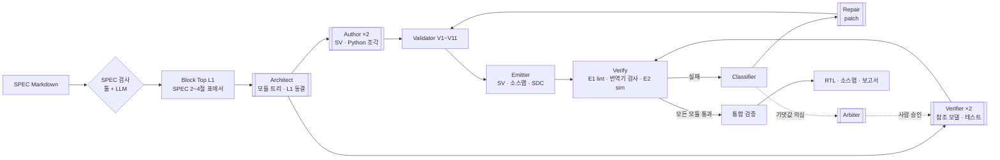
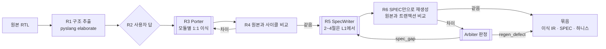

# RTL Factory

SPEC에서 RTL을 생성하고, 검증된 원본 RTL에서 IR과 SPEC을 만드는 IR 기반 하네스입니다. [chip-design-department](../chip-design-depart)의 실행 계층(파이프라인)을 부서 계층(Seat, 게이트웨이, 파이프라인 API) 없이 따로 쓰려고 떼어 낸 것입니다 (2026-10-23, 원본 커밋 `673bb08` 기준).

| 흐름 | 입력 | 출력 |
| --- | --- | --- |
| RTL 생성 | SPEC(Markdown, 10개 절) | IR, SystemVerilog, 소스맵, SDC 골격, 검증 결과, 보고서 |
| RTL → SPEC (이식) | 원본 RTL(.v, .sv, 헤더, define) | 원본과 사이클 등가인 이식 IR, SPEC, 생성 하니스 |

두 흐름은 한 묶음입니다. 이식 흐름의 마지막 단계(R6)가 SPEC만으로 RTL 생성을 다시 돌려 원본과 비교하는 SPEC 충실도 검사이기 때문입니다.

| 문서 | 내용 |
| --- | --- |
| [docs/LLM 기반 RTL 생성 파이프라인 설계.md](./docs/LLM%20기반%20RTL%20생성%20파이프라인%20설계.md) | SPEC 규격, 파이프라인, IR 스키마, Validator, 검증, 이식 |
| [docs/SPEC 작성 템플릿.md](./docs/SPEC%20작성%20템플릿.md) | 입력 SPEC의 10개 절 |
| [docs/RTL 코딩 규칙.md](./docs/RTL%20코딩%20규칙.md) | 생성 RTL이 지키는 규칙과 강제하는 검사 |
| [docs/용어집.md](./docs/용어집.md) | 문서와 코드에서 쓰는 말 |

---

## 1. 아키텍처

### 1.1 핵심 원칙

| 원칙 | 내용 |
| --- | --- |
| IR이 유일한 소스 | RTL은 늘 IR에서 방출합니다. RTL을 IR로 되돌리는 역파싱은 없고, 모든 수정은 SPEC이나 patch로 들어갑니다. |
| 구조는 툴, 동작은 LLM | 계층, 인터페이스, 상태 선언은 JSON이고 툴이 보장합니다. 동작은 타입이 붙은 슬롯 안의 조각(SV 또는 사이클 단위 Python)이라 오류가 조각 하나로 좁혀집니다. |
| 결정론적 제어 흐름 | 순서, 분기, 반복 상한, 게이트는 스케줄러가 정합니다. 에이전트끼리는 메시지를 주고받지 않고 산출물로만 통신합니다. |
| 생성과 검증의 격리 | Author와 Verifier는 서로의 산출물을 볼 수 없습니다. 격리는 프롬프트가 아니라 작업 디렉터리(macOS sandbox), patch 적용 툴, Validator V11(동결 해시)이 강제합니다. |
| coding agent 기반 | LLM은 모두 headless coding agent 세션(기본 Claude Code)으로 씁니다. 모델 API를 직접 부르는 코드는 없습니다. |
| 사람 결정 | 기댓값(테스트) 변경, Repair 충돌, 이식 R2의 L1 확정은 사람이 정합니다. 실행 중 게이트는 멈추지 않고 검토 항목으로 남깁니다. |

### 1.2 RTL 생성 (SPEC → RTL)



이중 괄호가 LLM 에이전트이고 나머지는 결정론적 툴입니다.

- **모듈 루프.** 트리 아래에서 위로, 같은 레벨은 병렬로 진행합니다. 부모는 통과한 실제 자식을 포함해 검증합니다.
- **중복과 선택.** Author 후보는 모든 Verifier의 테스트를 통과해야 하고, 그중 Repair와 lint 경고가 적은 후보를 고릅니다. Verifier 간 차분은 SPEC의 모호함을, Author 후보 간 차분은 테스트의 구멍을 찾습니다.
- **루프 제어.** 반복 상한, 예산 상한, IR 해시 진동 감지. patch 뒤에는 늘 Validator부터 다시 돕니다.

### 1.3 RTL → SPEC (이식 흐름)



| 단계 | 하는 일 | 통과 조건 |
| --- | --- | --- |
| R1 구조 추출 | 고정한 파라미터와 define으로 elaborate해 모듈 트리, 포트, 도메인·번들 후보를 뽑고 L1·L0 초안을 냄 | 초안 L1이 V1~V3 통과. 표현할 수 없는 구문은 거부 목록 |
| R2 L1 확정 | 툴로 알 수 없는 것(주파수, 도메인 관계, 프로토콜)과 검토 항목을 묻고 멈춤 | 모든 항목에 답 |
| R3 동작 이식 | Porter가 원본 모듈의 동작을 L2/L3으로 옮김. 모듈 구조는 원본과 1:1 | Validator 통과 |
| R4 이식 등가 | 원본 RTL과 방출 RTL에 같은 자극을 넣고 모든 출력을 사이클 단위로 비교 | 모든 모듈 `equal` |
| R5 SPEC 작성 | 2~4절은 L1에서, 나머지는 SpecWriter가 원본과 이식 IR을 읽고 `refsim`(원본에서 확인한 값)으로 씀 | SPEC 검사 게이트, SPEC의 L1 = IR의 L1 |
| R6 SPEC 충실도 | SPEC만으로 RTL 생성을 다시 돌려 원본과 트랜잭션 비교, 재생성 Verifier 테스트를 원본에 돌림 | 차분 없음, 테스트가 원본에서 통과 |

R6 판정이 `spec_gap`이면 SpecWriter가 SPEC을 고치고(상한 `spec_revise`), `regen_defect`면 RTL 생성 쪽 결함으로 리포트하고 끝냅니다. 결과 묶음은 RTL 생성의 입력으로 그대로 쓸 수 있습니다.

### 1.4 IR

IR은 모듈당 JSON 파일 하나입니다 (스키마: `schema/ir.schema.json`).

| 계층 | 필드 | 내용 |
| --- | --- | --- |
| L0 | `instances`, `connections` | 인스턴스와 연결 |
| L1 | `params`, `domains`, `ports` | 파라미터, 클럭·리셋 도메인, 포트와 프로토콜 번들 |
| L2 | `types`, `signals` | 타입, 신호 |
| L3 | `blocks`, `functions`, `assertions` | `comb`, `seq`, `fsm`, `cdc_sync`, `cdc_fifo`, `memory`, `tristate`, 함수, SVA |

모든 모듈의 L1과 인스턴스 목록, `top`/`block_top`의 연결은 Architect(이식에서는 R2) 뒤에 동결되고, Author·Repair·Porter는 L2와 L3만 씁니다.

### 1.5 코드 구성

| 경로 | 내용 |
| --- | --- |
| `pipeline/spec/` | SPEC 변환(PDF, WaveJSON, 레지스터 맵), SPEC 검사, SPEC 표 → L1 |
| `pipeline/agents/` | 에이전트(Architect, Author, Verifier, Repair, Arbiter, Porter, SpecWriter), 실행기와 격리(`task.py`, `runner.py`), 에이전트 도구(`pl.py`), 과제 안내(`prompts/`) |
| `pipeline/ir/` | IR 모델, Python 조각 → SV 번역기(`pyfrag.py`), 설계 모델 실행기(`pysim.py`) |
| `pipeline/validator/` | V1~V11 |
| `pipeline/emitter/` | IR → SV, 소스맵, SDC. 표준 셀 스텁(`stubs/`) |
| `pipeline/verify/` | E1 lint, E2 sim, 번역기 검사 |
| `pipeline/tb/` | cocotb 하니스 생성과 라이브러리, 차분 시뮬레이션, 불일치 리포트 |
| `pipeline/classifier/`, `pipeline/patch/` | 실패 분류, patch 적용 |
| `pipeline/importer/` | 이식 R1, R2, R4, R6 |
| `pipeline/scheduler/` | RTL 생성 스케줄러(`run.py`), 이식 실행기(`port.py`), 사람 결정(`approve.py`) |
| `pipeline/feedback/` | 외부 검사 리포트 파서(`config/report_formats/`), SPEC 변경 diff |
| `pipeline/cli.py` | `rtlf` 실행기 |
| `schema/` | IR JSON Schema |
| `config/` | 역할 설정(`roles*.json`), 에이전트 설정(`agents/`), 리포트 양식 |
| `blocks/`, `examples/` | 예시 SPEC |
| `tests/` | 시험. `tests/golden/`은 원본 RTL과 손으로 옮긴 IR이 있는 golden 블록, `tests/fixtures/`의 예시 IR은 Author·Architect 과제에도 들어감 |

## 2. 설치

| 구성 | 판 | 쓰는 곳 |
| --- | --- | --- |
| Python | 3.11 이상 | 전체 |
| Verilator | 5.052에서 확인 | E1 lint, E2 sim, 이식 R4/R6 원본 시뮬레이션 |
| coding agent CLI | Claude Code(기본). agy 등은 설정으로 | 에이전트 실행 |
| macOS `sandbox-exec` | | 에이전트 작업 디렉터리 격리 (없으면 격리할 수 없다는 오류. 시험용 `--no-isolate`만 예외) |

```bash
uv venv --python 3.11 .venv                 # 또는 python3.11 -m venv .venv
uv pip install --python .venv/bin/python -e ".[dev]"
.venv/bin/rtlf                              # 명령 목록
```

`rtlf`는 `schema/`, `config/`, 예시 IR을 저장소에서 찾으므로 editable 설치(`-e`)로 씁니다. 설치하지 않았으면 저장소 루트에서 `python3 -m pipeline`으로 같은 명령을 부릅니다.

선택 의존성: `spec`(PDF, 엑셀 SPEC 입력), `golden`(golden 블록의 원본 테스트벤치), `dev`(둘 다 + pytest).

### 2.1 에이전트 설정

역할 설정이 역할마다 에이전트, 후보 수, 상한을 정하고 에이전트 설정 파일을 가리킵니다.

| 파일 | 내용 |
| --- | --- |
| `config/roles.json` | 기본 (Claude Code, Sonnet) |
| `config/roles.port-haiku*.json` | 이식 흐름 실행에 쓴 설정 (Haiku, effort low/medium/high) |
| `config/agents/agents.*.json` | 에이전트별 실행 명령(`{prompt}`, `{model}` 자리), 모델, 계열, 시간 제한 |
| `config/agents/agents.example.json` | 로컬 모델 엔드포인트를 쓰는 예 |

```json
{
  "agents": "config/agents/agents.claude.json",
  "roles": {
    "architect": {"agent": "cc-verifier", "count": 1},
    "author":    {"agent": "cc-author",   "count": 2, "langs": ["sv", "py"]},
    "verifier":  {"agent": "cc-verifier", "count": 2},
    "repair":    {"agent": "cc-author",   "count": 1},
    "arbiter":   {"agent": "cc-verifier", "count": 1},
    "porter":    {"agent": "cc-author",   "count": 1},
    "spec_writer": {"agent": "cc-verifier", "count": 1}
  },
  "limits": {"repair_per_candidate": 3, "budget_agent_runs": 60, "porter_fix": 3, "spec_revise": 3}
}
```

- Author와 Verifier가 같은 계열이면 `MODEL_FAMILY` 경고가 검토 항목에 남습니다.
- 에이전트 작업 디렉터리는 저장소 밖(`CHIPDEPT_RUNS`, 기본 `~/.cache/rtl-factory/runs`)에 만들고 서로 격리합니다. 저장소 안이면 거부합니다.

## 3. rtlf 사용법

```text
rtlf                         명령 목록
rtlf <그룹>                  그룹의 명령 목록
rtlf <그룹> <명령> [인자...]  실행
rtlf ... <명령> --help       명령별 인자
```

| 명령 | 모듈 | 하는 일 |
| --- | --- | --- |
| `spec pdf` | `pipeline.spec.pdf` | PDF SPEC → Markdown |
| `spec waveform` | `pipeline.spec.waveform` | 타이밍 다이어그램 → WaveJSON (비전 coding agent) |
| `spec regmap` | `pipeline.spec.regmap` | 레지스터 맵(xlsx, CSV) 파싱과 검사 |
| `spec check` | `pipeline.spec.check` | SPEC 검사 게이트 |
| `spec llm-check` | `pipeline.spec.llm_check` | SPEC LLM 검사 |
| `spec l1` | `pipeline.spec.l1` | SPEC 2~4절 표 → Block Top L1 |
| `run` | `pipeline.scheduler.run` | RTL 생성 (SPEC → RTL) |
| `approve` | `pipeline.scheduler.approve` | 실행이 기다리는 사람 결정 보기와 결정 |
| `port` | `pipeline.scheduler.port` | 이식 흐름: `start`, `answer`, `resume`, `status` |
| `ir r1` | `pipeline.importer.r1` | 원본 RTL → 모듈별 L1·L0 초안 |
| `ir patch` | `pipeline.patch.apply` | IR에 patch 적용 |
| `ir emit` | `pipeline.emitter.sv` | IR → SystemVerilog, 소스맵 |
| `ir pyequiv` | `pipeline.verify.pyequiv` | 번역기 검사 (설계 모델 대 RTL) |
| `tb gen` | `pipeline.tb.gen` | L1 → cocotb 하니스 |
| `tb report` | `pipeline.tb.report` | sim 불일치 리포트, FSM 전이 커버리지 |
| `verify` | `pipeline.verify.run` | `lint`(E1), `sim`(E2) |
| `report` | `pipeline.feedback.reports` | 외부 검사 리포트 파서 |
| `tool` | `pipeline/agents/pl.py` | 에이전트 도구: `validate`, `emit`, `fanin`, `trace`, `spec`, `harness`, `model`, `pysim`, `porteq`, `refsim`, `spec_gate` |

인자와 종료 코드는 해당 모듈에 그대로 넘깁니다. `rtlf tool`로 사람이 부르면 에이전트 도구 사용 기록(`.tools.log`)을 남기지 않습니다.

## 4. 작업 흐름

### 4.1 SPEC 검사

SPEC은 [SPEC 작성 템플릿](./docs/SPEC%20작성%20템플릿.md)의 10개 절을 따릅니다.

```bash
rtlf spec pdf vendor_spec.pdf --pages 37-80 -o build/spec      # PDF가 원본이면 먼저 Markdown으로
rtlf spec check blocks/axis_crc_append/block_spec.md -o build/spec_check
rtlf spec l1 blocks/axis_crc_append/block_spec.md -o build/axis_crc_append.l1.json
```

`spec check`는 `review.md`(오류, 경고, 검토 항목)와 SPEC에서 만든 L1을 냅니다. 오류가 있으면 종료 코드가 0이 아닙니다.

### 4.2 RTL 생성

```bash
rtlf run blocks/axis_crc_append/block_spec.md --run-dir build/runs/crc --roles config/roles.json
```

- 멈췄다가 같은 명령으로 다시 실행하면 끝난 단계와 끝난 에이전트 작업을 건너뛰고 이어 갑니다.
- 실행 디렉터리: `state.json`(상태), `scheduler.log`, `ir/`(최종 IR), `rtl/`(SV, 소스맵, SDC), `harness/`, `verify/`, `diffsim/`, `tasks/`(에이전트 작업별 과제와 출력), `report.json`(최종 보고서).
- 기댓값 변경이나 Repair 충돌이 생기면 해당 모듈만 멈추고 사람 결정을 기다립니다.

```bash
rtlf approve build/runs/crc list
rtlf approve build/runs/crc show E1
rtlf approve build/runs/crc approve E1 --by kim --note "SPEC CRC-E01대로 리셋 다음 사이클부터"
rtlf approve build/runs/crc reject E1 --by kim --note "테스트가 맞음"
rtlf approve build/runs/crc resolve E2 --repair axis_crc_core --by lead --note "..."   # Repair 충돌
rtlf run blocks/axis_crc_append/block_spec.md --run-dir build/runs/crc --roles config/roles.json   # 결정 반영
```

결정은 `<run_dir>/decisions.json`에 남고 되돌리지 않습니다.

### 4.3 RTL → SPEC (이식)

```bash
rtlf port start tests/golden/axis_adapter/upstream/rtl/axis_adapter.v --top axis_adapter \
    -G S_DATA_WIDTH=8 -G M_DATA_WIDTH=32 -G M_KEEP_ENABLE=1 --run-dir build/port/adapter
rtlf port status --run-dir build/port/adapter          # R1 뒤 R2에서 멈추고, 물을 항목(questions)을 보여 줌
rtlf port answer --run-dir build/port/adapter freq.sys=100 \
    proto.axis_adapter.s_axis=valid_ready proto.axis_adapter.m_axis=valid_ready review.1=ok review.2=ok
rtlf port resume --run-dir build/port/adapter --roles config/roles.port-haiku-medium.json
```

- 원본 입력: 파일 목록, `-f`(filelist), `-I`(include 경로), `-D`(define), `-G`(고정 파라미터), `--lang verilog|sv`.
- 항목 ID는 `status`의 `questions`에 나옵니다: 주파수(`freq.<도메인>`, MHz), 도메인 관계(`rel.<a>.<b>`), 번들 프로토콜(`proto.<모듈>.<번들>`), R1 검토 항목(`review.<번호>`, `ok` 또는 `stop`). 답을 JSON 파일로 줄 때는 `--file answers.json`.
- `resume --until r4|r5|r6`으로 중간 단계까지만 돌릴 수 있습니다. SPEC 충실도 검사 없이 SPEC만 얻으려면 `--until r5`.
- R6 재생성 실행이 사람 결정으로 멈추면 `waiting_regen` 상태가 됩니다. 재생성 실행 디렉터리(`<run_dir>/r6/regen_<회차>`)에 `rtlf approve`로 결정하고 `port resume`으로 이어 갑니다.
- 결과 묶음: `<run_dir>/package/` (`ir/`, `spec.md`, `harness/`, `golden.json`).

### 4.4 개별 도구

```bash
rtlf tool validate tests/fixtures/pkt_parser.ir.json     # Validator (JSON 결과)
rtlf ir emit tests/fixtures/pkt_parser.ir.json -o build/emit
rtlf verify lint --top pkt_parser build/emit/pkt_parser.sv   # -Wall 경고도 실패로 셈 ("ok": false)
rtlf tb gen build/axis_crc_append.l1.json -o build/harness --trace-out build/trace
```

## 5. 시험

```bash
.venv/bin/python -m pytest -q --ignore=tests/sim     # 빠른 시험 (수 초)
.venv/bin/python -m pytest -q tests/sim              # 시뮬레이션 시험 (Verilator, 십여 분)
```

파이프라인 시험은 가짜 에이전트(`tests/fake_agent.py`, `tests/fake_port_agent.py`)로 돌므로 coding agent가 없어도 됩니다. golden 블록의 원본 테스트벤치는 `tests/golden/run_golden.py`로 돌립니다 ([tests/golden/README.md](./tests/golden/README.md)).

## 6. 원본에서 뺀 것

| 뺀 것 | 이유 |
| --- | --- |
| `pipeline/api/` (파이프라인 API 서버, 저장소) | 부서 계층과 게이트웨이가 실행을 제출하고 조회하는 접점 |
| `gateway/`, `department/` | 게이트웨이와 Web UI, Seat, OpenRig, Seat 도구(`deptctl`, `eda`) |
| `experiments/` | 단계별 실험. 에이전트 설정만 `config/agents/`로 옮김 |
| 부서·게이트웨이·P0 실험 시험 | `test_department`, `test_x1`, `test_x6`, `test_eda_comb`, `test_wavejson`, `tests/sim/test_api`, `tests/sim/test_gateway*` |
| ARCHITECTURE, IMPLEMENTATION, PROGRESS | 부서 계층을 포함한 원본의 계획과 기록. 원본 저장소에서 봅니다 |
